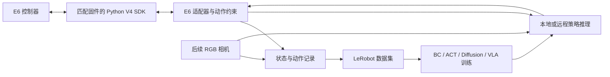

# 从 E6 到 π0.5：可实施的复现范围

核查日期：2026-09-16。主要依据：[Physical Intelligence openpi](https://github.com/Physical-Intelligence/openpi)、[π0.5 官方介绍](https://www.physicalintelligence.company/blog/pi05)、[LeRobot π0.5 文档](https://huggingface.co/docs/lerobot/pi05)。

## 1. “复现”可以分为三个目标

| 目标 | 所需工作 | 对本项目的判断 |
|---|---|---|
| 跑通公开模型推理/仿真 benchmark | 公开代码、权重、合适 GPU、对应环境 | 可以独立于 E6 先验证；结果只代表该模型/环境 |
| 在 E6 上适配并微调公开权重 | E6 驱动、示范数据、观察/动作映射、训练、部署与实机评估 | 推荐的实际目标 |
| 从零重现原论文完整训练及开放世界泛化结果 | 原训练数据混合、采集规模、模型配方、大规模算力和原评估条件 | 不能由买一台 E6、下载权重或复现少量任务替代 |

openpi 当前公开 π0、π0-FAST 与 π0.5 模型，并提供预训练权重和微调示例。README 表示基础模型使用 10k+ 小时机器人数据，并明确当前 π0.5 训练和推理支持 flow matching 动作头。公开项目与原论文整套系统的覆盖范围必须分别核对。

这意味着可以尝试，但不能承诺原始权重在 E6 上零样本即用。E6 的关节结构、动作表示、相机视角、夹爪和训练数据分布都需要适配。

## 2. 推荐的技术栈



首阶段直接 TCP/IP 更简洁。需要 ROS 规划或多传感器协作时再加 ROS 2。对 E6 的实际执行约束放在适配器里，避免每换一种模型就重新实现一套硬件控制。

LeRobot 当前官方硬件列表与本次检查的源码路径未见 E6；因此按自定义硬件适配来安排工作。至少需要实现连接/断开、观察读取、动作下发、特征定义和配置管理，并按当前版本接口补齐校准/状态属性。

## 3. 算法选择顺序

| 算法 | 适合阶段 | 优势 | 对 E6 的实际工作 |
|---|---|---|---|
| 小型状态输入 BC | 现在、无相机 | 最容易看清数据与动作语义 | 关节状态+目标输入；自定义小模型即可 |
| [ACT](https://github.com/tonyzhaozh/act) / [LeRobot ACT](https://huggingface.co/docs/lerobot/act) | 有示范数据后 | 成熟的动作片段预测方法，适合先建立模仿学习基线 | 配置观察、动作维度、采样率；视觉任务再接图像 |
| [Diffusion Policy](https://github.com/real-stanford/diffusion_policy) | 动作与数据流程稳定后 | 适合比较连续动作策略 | 处理动作片段与执行延迟；不能直接照搬别的机器人控制量 |
| [SmolVLA](https://huggingface.co/docs/lerobot/smolvla) | 有相机、希望体验语言条件策略 | 比大型 VLA 更适合探索较轻量方案 | 仍需 E6 数据与适配，不是即插即用 |
| [π0.5 / openpi](https://github.com/Physical-Intelligence/openpi) | 已有可靠数据、执行与评估流程 | 官方模型与权重，适合向目标算法推进 | 自定义数据配置、状态/动作变换、归一化、微调和实机验证 |
| [π0.5 / LeRobot](https://huggingface.co/docs/lerobot/pi05) | 希望统一在 LeRobot 中训练部署 | 已有 PyTorch 策略集成 | 固定 LeRobot 版本，核对训练配置与 checkpoint 语义 |

不必把每种算法都做一遍。推荐主线是 **状态 BC → 一个稳定的模仿学习基线 → π0.5**。ACT 或 Diffusion 选其中之一即可。

## 4. 无相机阶段与视觉阶段的边界

裸臂可完成程序控制、示范记录与状态输入策略。没有图像的状态实验不验证 π0.5 的视觉语言泛化能力。

如果现在就想熟悉 π0.5，可以先用公开数据或 LIBERO 仿真跑模型，再并行准备 E6 的驱动和数据流程。openpi 的无机器人推理示例只证明推理链路运行，不代表模型已能控制 E6。

后续最小视觉实验可以只增加一台固定 RGB 相机：例如根据彩色标记的位置，移动到该标记上方。先固定任务范围和视角。深度相机、腕部相机和夹爪按任务再添加，不把它们当作学习算法的统一前置采购条件。

视觉策略的输入必须有真实、同步且与训练一致的图像。空图像、随机图像、缺失相机的掩码配置只能用于对应的调试或模型配置，不能替代视觉观测并声称获得了视觉能力。

## 5. 数据与动作空间先约定清楚

第一版裸臂数据可用六维关节状态与六维关节目标：

```text
observation.state = [q1, q2, q3, q4, q5, q6]
action            = [q1_target, ..., q6_target]
task              = 任务标签 / 目标条件
timestamp         = 同步时间戳
```

这只是 E6 项目的设计示例，不是所有 π0.5 checkpoint 的通用输入格式。若任务目标会变化，必须通过状态特征、语言指令或其他明确输入提供目标信息。

增加相机与夹爪后，可以扩展为：

```text
observation.images.front = RGB 图像
observation.state        = [q1, ..., q6, gripper_state]
action                   = [q1_target, ..., q6_target, gripper_command]
task                     = 自然语言任务
```

如果夹爪只有开/关控制，`gripper_command` 的语义就是离散开/关；不能假装它是可连续控制并带反馈的开度。未来改动作定义时需要更新数据 schema 和训练配置。

也可以选末端空间增量，但这还要明确平移单位、旋转表示、在哪个坐标系组合增量、IK 解选择和不可达目标处理。六轴机器人并不意味着可以把任意六个模型输出当成六个关节角。

适配时至少核对：

1. 关节顺序、方向、度/弧度、毫米/米。
2. 绝对目标、增量、速度三种动作语义。
3. 采样周期、观察到动作的时间偏移、动作片段长度。
4. 图像通道、大小、相机键名、掩码与预处理。
5. 数据归一化统计与模型训练/部署时的一致性。
6. 模型内部动作填充维度与实际 E6 动作维度。

**不能把 Franka/DROID 的七关节动作直接截成六维发给 E6。** 内部 padding 只解决张量形状，不自动解决机器人运动学差异。

## 6. 控制频率与模型推理要分开

模型一次可能输出未来一段动作。推理服务与本地执行循环分别负责生成动作与按时执行，并通过反馈继续更新观察。

openpi 官方提供 [远程推理方案](https://github.com/Physical-Intelligence/openpi/blob/main/docs/remote_inference.md)，可以让连接机械臂的电脑与运行 GPU 模型的电脑分开。远程推理不能替代本地对关节目标、运动范围、动作超时与连接中断的处理。

在决定策略 Hz 或 `ServoJ` 周期之前，实测以下数据：反馈年龄、命令往返延迟、模型推理延迟、实际轨迹跟踪误差。先用最小任务确定可运行参数，不直接照搬别的平台的 30/50/100 Hz。

## 7. 算力与系统

openpi README 在本次核查时给出的单 GPU 估算：

| 模式 | README 显存要求 | 使用解释 |
|---|---|---|
| 推理 | >8 GB | 只是文档下限估算，不保证任意 8–12 GB 显卡/配置都能顺畅运行 |
| LoRA 微调 | >22.5 GB | 24 GB 档非常接近该估算下限，依赖实现、精度、batch 和图像配置 |
| 全量微调 | >70 GB | 文档举例 A100 80 GB / H100 级别 |

openpi 表示测试环境为 Ubuntu 22.04，当前不支持其他操作系统。E6 Python SDK 可在 Windows/Linux 使用，因此可以现在在 Windows 学控制，训练阶段单独安排 Linux 或远程 GPU。

openpi 当前 README 的 PyTorch 支持说明还列出不支持 LoRA 等限制。不能把其通用 LoRA 显存表直接当作该 PyTorch 路径的安装承诺。LeRobot 的 π0.5 是另一条实现路线，必须按固定版本的文档评估。

LeRobot 当前文档有为单张 80 GB GPU 设置的 π0.5 LIBERO 微调示例，也有冻结 VLM/只训练动作专家的配置。这些是配置示例，尚未在你的电脑上测量。

本次通过 `nvidia-smi` 读取到当前电脑为 RTX 5070 Ti，显存 16303 MiB（约 16 GB），驱动 616.56；系统为 Windows 11 专业版。这是当前电脑的配置，不代表你最终必须在此训练。

这台电脑可以先承担控制和数据工作，也可安排小型策略训练及 π0.5 推理实验。16 GB 低于 openpi README 的常规 LoRA 微调估算，不能直接承诺按其默认方案本地微调成功。后续可评估其他冻结/轻量微调配置或远程训练；还需验证 RTX 50 系 GPU 与所选 CUDA、PyTorch/JAX 版本的兼容性及实际显存占用。本次未安装或运行模型。

最初的控制、数据检查、轨迹回放都不要求大型 GPU，不需要先采购训练显卡。

## 8. 分阶段验收

| 阶段 | 必须得到的结果 |
|---|---|
| A：只读通信 | 可靠读出状态，并可识别断线与过期反馈 |
| B：运动接口 | 小范围目标可执行、可停止，且动作与反馈单位一致 |
| C：记录/回放 | 有版本元数据的 episode，可离线检查并重复回放 |
| D：学习基线 | 对保留的初始状态/目标报告成功率和误差，与传统控制或简单策略对比 |
| E：视觉任务 | 图像与动作同步，固定相机任务重复成功，建立新位置测试集 |
| F：π0.5 微调 | 适配 E6 数据配置、完成归一化与训练，并验证预测动作的语义和范围 |
| G：实机部署 | 先离线/不执行动作的推理检查，再做受约束的实机试验，统计成功率和失败类型 |

论文复现记录应包含代码提交、依赖版本、数据划分、随机种子、训练参数、checkpoint、动作表示、控制频率、相机设置、测试条件和失败记录。达到某个单任务的高成功率，不能推断已经复现开放世界泛化。
