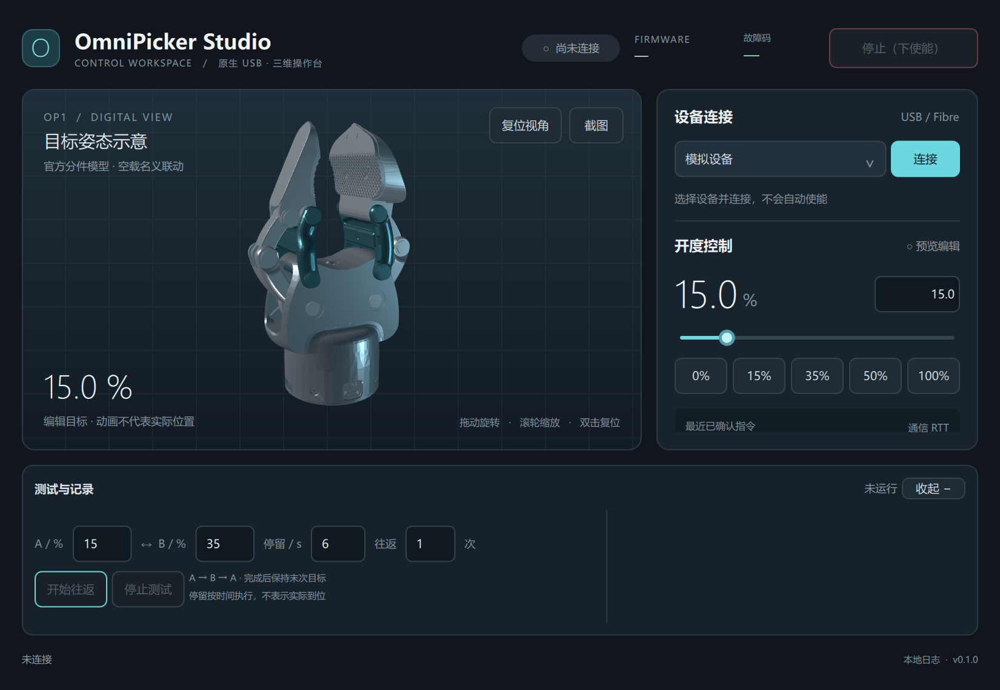
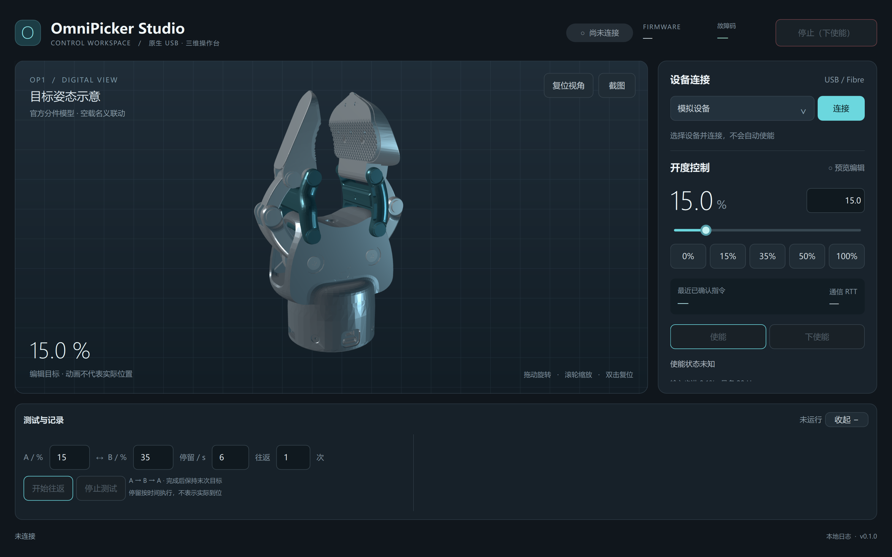
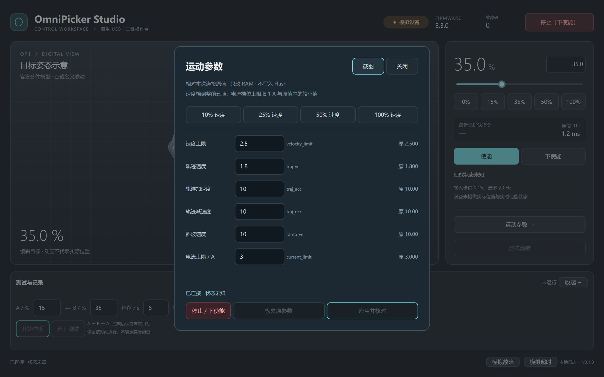
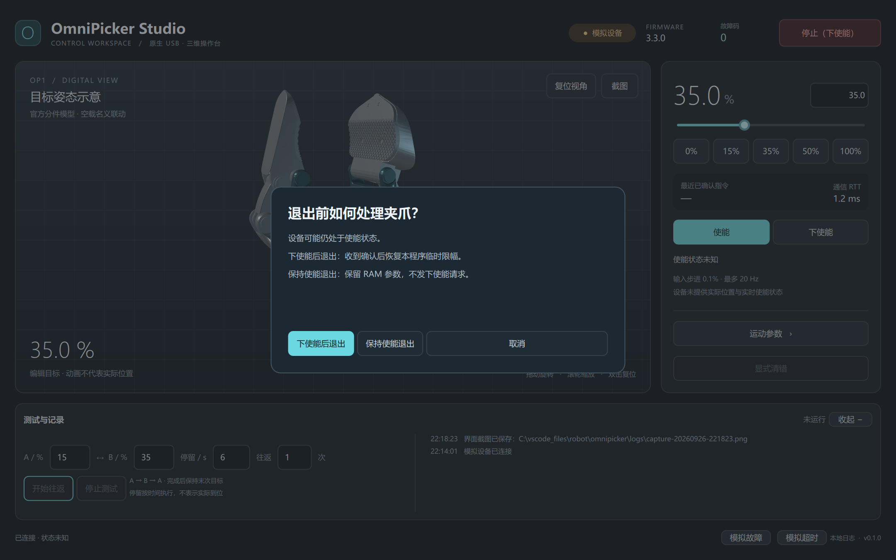
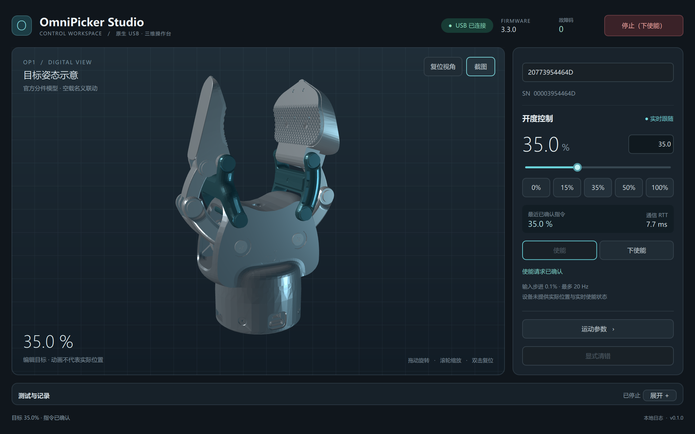

# OmniPicker Studio v0.1.0 验收记录

日期：2026-09-26，Asia/Shanghai。交付目录：`C:\vscode_files\robot\omnipicker`。

## 交付与环境

已创建独立 Conda 环境 `omnipicker`，Python 3.11.16；开发、运行、测试使用该环境。PySide6 6.8.3 / Qt Quick 3D、PyUSB 1.3.1、libusb-package 1.0.26.3、NumPy 2.2.6；完整固定依赖见 `requirements.txt`，环境定义见 `environment.yml`。`pip check` 通过。

`launch.cmd` → `launch.ps1` 自动定位环境并启动桌面窗口，已经实测。程序默认模拟模式且未连接，单实例锁防止重复启动竞争 USB。运行记录、截图缓存及本地设置忽略，正式证据和关键截图保留在本目录。

## 离线与渲染检查

最终 `python -m pytest -q --junitxml=logs/offline-tests.xml`：**38 passed**，2.37 秒。测试涵盖协议编码和 CRC、应答匹配和超时、百分比转换、原生只读连接、未知接口写锁定、目标覆盖与频率、停止优先级、有限测试与手动互斥、故障中止、重连不续跑、临时参数恢复及退出失败分支。另含“使能 ACK 丢失后仍须下使能”的回归用例。

官方 11 link / 10 joint / 9 STL 完整加载；1001 个开度采样检查名义连杆闭合与连续性。QML 初始化无警告，加载网格有有效顶点，程序化退出后窗口不可见。

Windows 原生缩放 150%（DPR 1.5），另设置 `QT_SCALE_FACTOR=1.5` 验证有效 225%（DPR 2.25）。两组均渲染 1100×760 和 1440×900 逻辑尺寸。最小窗口右侧可滚动，停止入口与底部测试保持可用。独立缩放测试 1 passed。XML 记录：[完整测试](evidence/offline-tests.xml)、[缩放测试](evidence/scaling-tests.xml)。

## Computer Use 操作检查

通过 Windows Computer Use 操作实际 Qt 窗口。模拟模式与真实模式由界面和日志明确标识。

| 检查 | 结果与范围 |
|---|---|
| 连接、使能、下使能 | 模拟与 USB 均验证；连接不发送状态或开度写入 |
| 连续滑块与预设 | 模拟检查全范围；实机仅 15–35% |
| 输入框联动 | 输入 24.7、Enter 后滑块为 24.7；再按 35% 预设，输入框更新为 35.0 |
| 参数面板 | 六项原值显示，10% 档应用并读回；未下使能时应用按钮禁用 |
| 有限次往返 | 模拟完成默认 15↔35、6 秒、1 次；运行时手动控制禁用 |
| 停止与异常 | 停止取消待发动作；模拟故障与超时锁定运动、取消测试，无旧目标重放 |
| 清错 | 控制层测试显式清错后仍下使能；真实设备未清错 |
| 三维操作 | 实际拖动旋转、滚轮缩放、复位；可折叠日志与滚动参数区 |
| 退出 | 取消保留窗口；22:19 模拟设备“保持使能退出”后窗口及进程均结束；下使能恢复路径经控制层和实机复验 |

## 实机只读对照

先对照先前官方 REF-CLI 的身份和六项配置，再由新驱动只读获取。内部 SN `00003954464D`，USB SN `20773954464D`，VID/PID `1001:03EF`，固件 `330`，device_type=1，CAN ID=1，POSITION_RAMP=5，calib_valid=True，故障 0。只使用 WinUSB interface 2，未使用 COM29，未 reset USB。

原始设备 JSON 与 REF-CLI 导出定义的差异仅为 CLI 注入的 `mode:r` 辅助字段；端点、类型和访问定义一致。原始 schema SHA-256 与 CRC 见[模型与协议说明](MODEL_AND_PROTOCOL.md)。[只读证据](evidence/readonly-20260926-215045.json)明确标记 `writes_performed=false`。

## 小范围实机操作

沿用用户先前确认的固定、行程清空与低速 15–35% 授权。通过新 GUI 先下使能，将前五项限幅设为基准的 10%，电流 3→1 A，逐项读回，然后使能。

| 本地时间 | 软件确认 |
|---|---|
| 22:01:02 | 原生 USB 只读连接 |
| 22:01:39 | 下使能请求返回成功 |
| 22:02:45 | 低速临时限幅应用并读回 |
| 22:03:30 | 使能请求返回成功，未附带新目标 |
| 22:03:44 | 15% 目标指令确认 |
| 22:04:03 | 拖动到 33.2%，释放再提交相同末值；两次确认间隔约 77 ms |
| 22:04:23 | 35% 目标指令确认 |
| 22:04:53 | 15% 目标指令确认 |
| 22:05:48 | 下使能请求返回成功 |

该实机 GUI 会话 **1467 次故障查询均为 0**。USB 事务 RTT 中位数约 **6.35 ms**，P95 约 **9.66 ms**（按排序后 95% 索引取值；不是运动响应时间）。[动作与统计摘要](evidence/real-gui-session-summary.json)保留原始日志 SHA-256，原始 JSONL 留在本地 `logs/`。

## 验收中发现的问题与修复

1. 固件对重复下使能返回 False。首次 GUI 退出再次发同一状态转换，被正确标为“停止未确认”，当时未自动恢复参数。修复后，仅本程序已有成功下使能确认、且之后没有可能使能的请求时，省去重复状态请求。未知状态不推断为已下使能。
2. 22:08:30 根据此前已确认下使能且无后续动作的记录，通过同一原生驱动恢复六项原值并读回，故障 0：[恢复记录](evidence/parameter-recovery.json)。
3. 22:10:54 用修复后的控制层再次进行使能→下使能→临时改参→下使能退出，成功恢复原值、释放连接，并独立读回核对；该轮**没有发送开度命令**：[最终实机退出验证](evidence/final-exit-validation.json)。
4. 修复了 Qt 关闭事件反复拦截退出、Enter 后输入框不再随预设同步、参数弹窗底部截断，以及自动测试期间手动目标在结束后重放的问题。对应回归或界面复验通过。

## 最终状态与结论边界

最后实机请求结果为**下使能已确认，六项原限幅已恢复，故障 0**：velocity_limit=2.5、traj_vel≈1.8、traj_acc=10、traj_dcc=10、ramp_vel=10、current_limit=3。之后界面检查仅使用模拟设备。没有写 Flash、校准、升级或操作 E6。

本轮新 GUI 的现场平稳性/声音观察已询问用户，截至本记录尚未取得答复。用户此前“确实开合，平稳无异响”属于先前 REF-CLI 的基础动作验收，不能替代本轮观察。

软件确认不等于实际到位。固件没有实时位置、速度、电流和使能反馈；三维仅为基于官方模型的空载名义目标姿态，未校准真实角度或毫米开度。全行程、带载和精度未实机验收，异常只在模拟器注入。停止受单笔 USB 事务超时影响，不是硬件急停。
